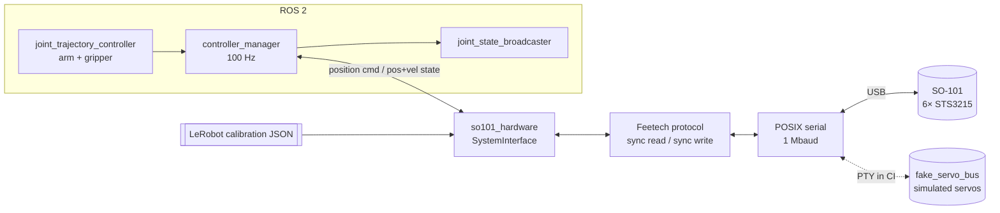

# SO-101 Control

[](https://github.com/mike200004/so101-control/actions/workflows/ci.yml)

A ROS 2 Jazzy control stack for the [SO-101](https://github.com/TheRobotStudio/SO-ARM100)
robot arm: a `ros2_control` hardware driver for its Feetech STS3215 servo bus,
the robot description, controllers and launch files. It also contains the
hands-on [learning workspace](#learning-workspace) used to get the arm running
with LeRobot.

The driver reads **LeRobot's own calibration files**, so an arm calibrated once
with `lerobot-calibrate` reports the same joint angles in ROS 2 and in LeRobot,
and the same arm can be used for LeRobot teleoperation / data collection and
for ROS 2 planning and control.



## Packages

| Package | What it contains |
|---|---|
| [`so101_hardware`](ros2/so101_hardware) | C++ `ros2_control` plugin; ROS-independent Feetech protocol library; servo bus simulator; `so101_bus_tool` diagnostics |
| [`so101_description`](ros2/so101_description) | xacro URDF, meshes and `ros2_control` block (real or mock hardware) |
| [`so101_bringup`](ros2/so101_bringup) | Controller configuration and the main launch file |

## Quick start

Build (Ubuntu 24.04 + ROS 2 Jazzy, or use the [Docker image](docker/Dockerfile)):

```bash
mkdir -p ~/so101_ws/src && cd ~/so101_ws/src
git clone https://github.com/mike200004/so101-control.git
cd .. && rosdep install --from-paths src --ignore-src -y
colcon build && source install/setup.bash
```

**No arm needed**: run the real driver against a simulated servo bus:

```bash
ros2 launch so101_bringup so101.launch.py hardware:=fake_bus rviz:=true
```

**Real arm**: check the wiring and calibration first (read-only, never enables torque):

```bash
CAL=~/.cache/huggingface/lerobot/calibration/robots/so_follower/<robot id>.json
ros2 run so101_hardware so101_bus_tool --port /dev/ttyACM0 scan
ros2 run so101_hardware so101_bus_tool --port /dev/ttyACM0 --calibration $CAL joints
```

then bring it up (the arm holds its current pose when torque comes on):

```bash
ros2 launch so101_bringup so101.launch.py hardware:=real port:=/dev/ttyACM0 calibration_file:=$CAL
```

and send it somewhere:

```bash
ros2 action send_goal /arm_controller/follow_joint_trajectory control_msgs/action/FollowJointTrajectory \
  "{trajectory: {joint_names: [shoulder_pan, shoulder_lift, elbow_flex, wrist_flex, wrist_roll],
    points: [{positions: [0.0, -0.3, 0.3, 0.0, 0.0], time_from_start: {sec: 3}}]}}"
```

> Clamp the arm down and clear its workspace before enabling torque. Deactivating
> the hardware (or stopping the launch) disables torque, and the arm will sag.

## Design notes

**Joint zero and units.** Arm joints use the middle of each calibrated range as
zero, which is both LeRobot's `MotorNormMode.DEGREES` convention and the zero
pose of the upstream `so101_new_calib` URDF:
`q = s · (raw − (min + max)/2) · 2π/4096`, with `s = −1` when `drive_mode = 1`.
LeRobot uses 4095 steps per revolution in the denominator rather than 4096; the
difference is under 0.05° anywhere in the workspace, and a unit test pins it.
The gripper is mapped linearly from its calibrated range onto the URDF jaw
limits (LeRobot reports it as 0–100 %).

**Safety on startup.** Configure fails, before any torque is applied, if a servo
is missing, is not an STS3215, or has a stored homing offset that differs from
the calibration file (the usual symptom of the wrong port, the other arm, or a
stale calibration). Activation sets every goal to the present position before
enabling torque, so the arm never jumps to an old goal.

**Bus efficiency.** One control cycle is a single 4-byte sync read (position +
velocity for all six servos) and, only if a goal changed, one sync write: about
1 ms of bus time at 1 Mbaud, so 100 Hz control has plenty of margin.

**EEPROM care.** PID gains (LeRobot's defaults P=16, I=0, D=32) live in EEPROM;
the driver reads them first and only unlocks and writes when they differ.

**Fault handling.** A missing reply in one cycle keeps the last state and logs
a throttled warning. After `max_consecutive_read_failures` cycles in a row the
driver returns an error to the controller manager. Servo status bits
(overload, overheat, voltage, ...) are decoded and logged.

## Testing

Everything runs in CI on every push (see [`ci.yml`](.github/workflows/ci.yml)):

| Test | What it covers |
|---|---|
| `test_protocol` | Byte-exact packets, parser resync and checksum rejection, sign-magnitude, sync read/write, missing servos, status errors |
| `test_joint_mapping` | Raw↔radian round trip for every step, drive-mode inversion, clamping, gripper mapping, parity with LeRobot's formula, calibration parsing |
| `test_so101_system` | Plugin lifecycle against the simulated bus: homing-offset check, no-jump activation, EEPROM writes only when needed, dropout tolerance, torque release |
| `test_load_plugin` | Plugin loads through pluginlib |
| `test_urdf` | xacro expands, meshes exist, `ros2_control` limits match URDF limits |
| `test_fake_bus_bringup` | Full launch: driver → serial (PTY) → simulated servos; a trajectory goal reaches its target |

The servo bus simulator ([`servo_bus_sim.cpp`](ros2/so101_hardware/src/sim/servo_bus_sim.cpp))
speaks the real wire protocol, including EEPROM lock behaviour and silent
servos, so the driver is tested at the byte level rather than against mocks.

## Status and roadmap

- [x] `ros2_control` driver, description, bringup, CI
- [ ] Validate on the physical arm (wiring check, joint directions, gripper direction, trajectory tracking error)
- [ ] MoveIt 2 configuration
- [ ] Record demonstrations and train an ACT policy with LeRobot (project 2)

## Learning workspace

The original lessons for running the arm with LeRobot are in
[Training/](Training/README.md): system map, port discovery and calibration,
teleoperation, data recording, training and troubleshooting.

| Item | Value |
|---|---|
| Follower calibration ID | `michael_arm` |
| Leader calibration ID | `michael_leader` |
| Calibration files | `~/.cache/huggingface/lerobot/calibration/` |
| VS Code tasks | **Terminal → Run Task** (uses `~/so101-env`) |

## License and credits

Apache-2.0. Robot meshes, kinematics and inertias are from
[TheRobotStudio/SO-ARM100](https://github.com/TheRobotStudio/SO-ARM100)
(Apache-2.0); see [`meshes/NOTICE.md`](ros2/so101_description/meshes/NOTICE.md).
The STS3215 control table follows the Feetech datasheet and
[LeRobot](https://github.com/huggingface/lerobot)'s motor tables.
